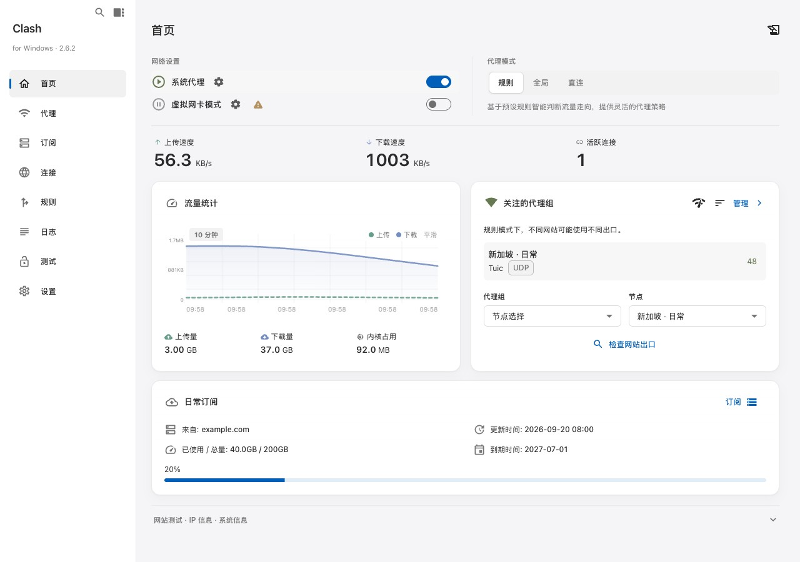
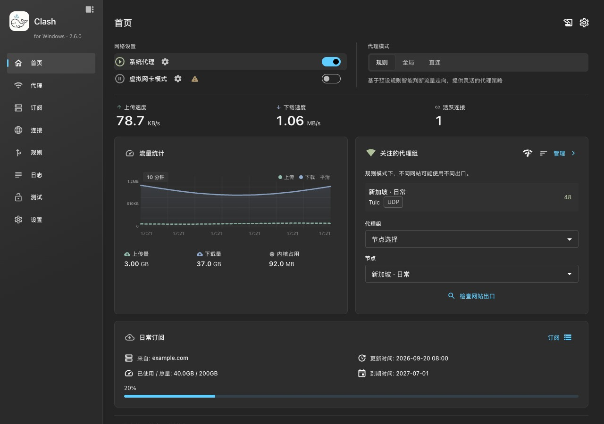
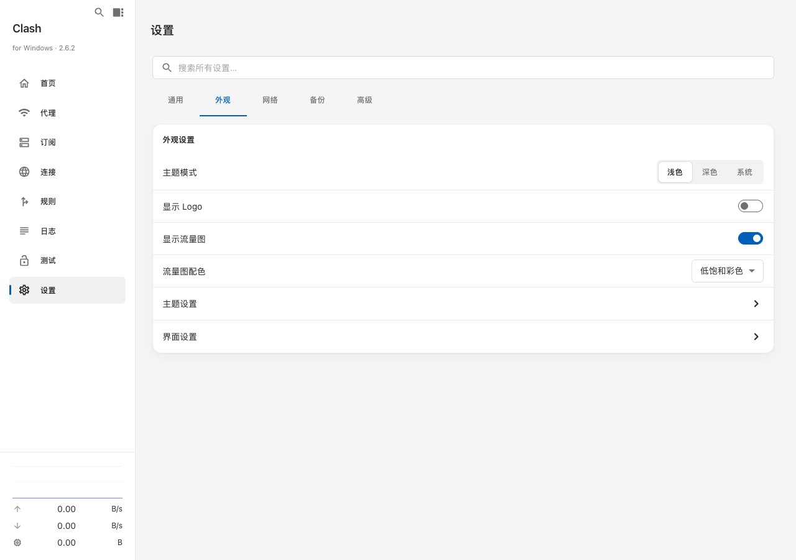
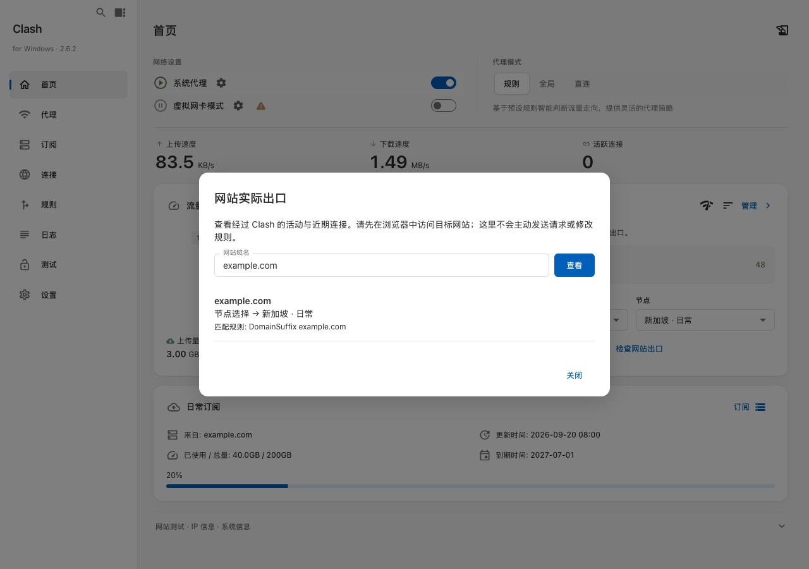

<p align="center">
  
</p>

<h1 align="center">Clash</h1>

<p align="center">一个安静、清晰的 Windows 桌面代理客户端</p>

<p align="center">
  <a href="https://github.com/mraz2766/clash_mraz/releases">下载</a> ·
  <a href="#在-windows-上使用">安装</a> ·
  <a href="docs/usage.md">使用说明</a> ·
  <a href="docs/ui-design.md">设计规范</a>
</p>

<br />

| 浅色 | 深色 |
| --- | --- |
|  |  |

基于 [Clash Verge Rev](https://github.com/clash-verge-rev/clash-verge-rev) 二次开发，内核为 [Mihomo](https://github.com/MetaCubeX/mihomo)。保留原有的代理能力，重新整理了界面与安装体验。

## 本次更新 · 2.6.1

首页选择器更紧凑，节点菜单限高滚动。右上角齿轮打开外观设置；首页模块在 **设置 → 通用 → 首页显示内容** 中调整。运行 `powershell -ExecutionPolicy Bypass -File scripts\build-windows.ps1 -Install` 可在本地构建并覆盖安装，EXE 位于 `releases/`。GitHub 自动构建保持关闭。

## 特点

- **贴近 Windows 11**：系统默认强调色，4px 控件与 8px 卡片圆角，统一的开关与分段控件，浅色和深色同样自然。
- **首页即工作台**：系统代理、TUN 与代理模式放在最上方，实时速度、关注的代理组和流量趋势一屏可见，诊断信息按需展开。
- **状态一目了然**：选中的节点和页面带强调色竖条，切换中、延迟和失败都有明确反馈。
- **轻量常驻**：窗口隐藏到托盘时暂停界面刷新，页面按需加载，规则等大数据只在用到时读取。
- **键盘友好**：`Ctrl+,` 打开设置，`Ctrl+1–8` 切换页面，`Ctrl+B` 折叠侧栏；输入框和弹窗内不会被抢占。

<details>
<summary>更多截图</summary>
<br />





</details>

## 在 Windows 上使用

支持 Windows 10 / 11（64 位）。两种方式任选其一，本项目不提供代理订阅。

### 方式一：下载安装（推荐）

1. 打开 [Releases](https://github.com/mraz2766/clash_mraz/releases)，下载 `Clash_<版本>_x64-setup.exe`。
2. 双击运行，按向导完成安装。升级时直接覆盖安装，订阅与设置会保留。
3. 在「订阅」导入订阅或本地配置，到「代理」选择节点，再按需开启系统代理或 TUN。

### 方式二：一键构建并安装

1. 获取源码：`git clone https://github.com/mraz2766/clash_mraz.git`，或在仓库页面选择 **Code → Download ZIP** 并解压。
2. 在源码目录打开 PowerShell，运行：

   ```powershell
   powershell -ExecutionPolicy Bypass -File scripts\build-windows.ps1 -InstallTools
   ```

3. 构建完成后会自动打开安装向导，按提示安装即可。

脚本会依次检查并准备 Node.js、Rust、Visual Studio C++ 构建工具和 pnpm，然后安装依赖、构建安装包。`-InstallTools` 表示缺少的工具通过 winget 自动安装，期间会弹出安装程序和管理员授权；已经装好时可以省略。首次构建需要联网，耗时较长。

| 参数 | 作用 |
| --- | --- |
| `-InstallTools` | 缺少构建工具时自动安装 |
| `-NoLaunch` | 只生成安装包，不打开安装向导 |
| `-Release` | 使用正式配置构建，耗时更长 |

安装包保存在 `releases\Clash_<版本>_x64-setup.exe`，可以复制到其他电脑安装。

### 开发与检查

```powershell
pnpm dev          # 启动桌面开发版
pnpm typecheck    # 类型检查
pnpm lint         # 代码检查
pnpm test         # 单元测试
```

`pnpm web:dev` 只启动前端，浏览器里没有 Tauri 原生能力，不会运行代理内核。更多细节见 [Windows 构建说明](docs/windows-build.md)。

## 须知

- **发布**：本地构建、手动发布。GitHub 工作流只保留手动触发，日常提交不会触发云端打包。
- **更新**：应用内自动更新仍指向上游。请从本仓库手动安装新版本，避免定制界面被覆盖。
- **兼容**：为沿用已有配置和服务，内部的可执行文件名、服务标识、数据目录与 URL 协议保留原项目名称。
- **共存**：与上游版本共用内部标识，不能同时运行。
- **macOS**：在独立的 `clash-mac` 分支维护，本页步骤仅适用于 Windows。

## 文档

- [使用说明与常见问题](docs/usage.md)
- [Windows 构建与安装](docs/windows-build.md)
- [视觉与交互规范](docs/ui-design.md)
- [Logo 与图标资源](docs/branding.md)
- [参与开发](CONTRIBUTING.md) · [更新日志](Changelog.md)

## 致谢

感谢 [Clash Verge Rev](https://github.com/clash-verge-rev/clash-verge-rev)、[Clash Verge](https://github.com/zzzgydi/clash-verge) 与 [Mihomo](https://github.com/MetaCubeX/mihomo) 的作者和贡献者。交互动效参考 [Amicro](https://github.com/Subhan-code/Amicro--Micro-transitions-)，Logo 整理参考 [ip-as-logo-skill](https://github.com/s1dashu/ip-as-logo-skill)。

以 [GPL-3.0-only](LICENSE) 许可发布，保留上游版权与第三方归属。
